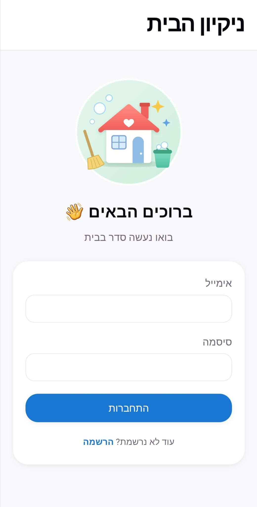
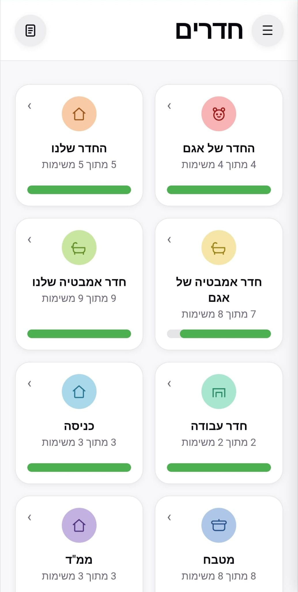

# Home Cleaning API

REST API for a household cleaning app. Members of a household share rooms and recurring cleaning tasks, mark tasks as done, and get push notifications: when someone else completes a task, and as a scheduled digest of upcoming tasks. Every completion is saved to a history of who did what and when. Members can also report a task in free text (for example, in Hebrew, "I cleaned the toilet in Agam's bathroom"), and an LLM finds the matching task.

## Live demo

- **App:** [home-cleaning-ui.vercel.app](https://home-cleaning-ui.vercel.app/)

> The API runs on Render's free tier, which sleeps when idle. The first request after a quiet period can take up to a minute while the server wakes up.

<p>
  
  
</p>


## Tech stack

- **Runtime:** Node.js 22, Express 5
- **Database:** MongoDB with Mongoose, using transactions for multi-document writes
- **Cache / rate limiting:** Redis
- **Background jobs:** BullMQ on Redis (retries with exponential backoff, scheduled jobs)
- **Auth:** JWT, role-based authorization, household-level data isolation
- **Notifications:** Web Push (VAPID)
- **AI:** Claude API (Claude Haiku 5.5) with structured outputs, schema defined with Zod
- **Docs:** Swagger / OpenAPI, Postman collection
- **Testing:** Jest, Supertest, mongodb-memory-server (in-memory replica set)
- **CI/CD:** GitHub Actions, deployed to Render after tests pass
- **Local environment:** Docker, Docker Compose

## Run locally with Docker (recommended)

Requires only [Docker Desktop](https://www.docker.com/products/docker-desktop/).

```bash
git clone https://github.com/ronyitz/home-cleaning-api.git
cd home-cleaning-api
docker compose up -d
```

This starts three containers: the API, MongoDB and Redis. No `.env` file is needed.

- API: http://localhost:3001
- Health check: http://localhost:3001/api/health
- Swagger docs: http://localhost:3001/api-docs

Useful commands:

```bash
docker compose up --watch      # live reload: code changes in src/ restart the API
docker compose logs -f api     # follow API logs
docker compose down            # stop (data is kept in a volume)
docker compose down -v         # stop and wipe the local database
```

To enable push notifications locally, create a `.env` file with VAPID keys (see `.env.example`). To use the AI command endpoint, add an `ANTHROPIC_API_KEY` to the same file.

## Run locally without Docker

Requires Node.js 22, plus a MongoDB and a Redis instance (local or hosted). MongoDB must run as a replica set, because signup uses transactions. MongoDB Atlas already does; a local standalone server does not.

```bash
npm install
cp .env.example .env    # then fill in the values
npm run dev
```

The API runs on http://localhost:3000.

## Tests

```bash
npm test
```

Tests run automatically on every push and pull request via GitHub Actions.

## API overview

All routes are under `/api`. Full documentation is available in Swagger at `/api-docs`.

| Area | Routes |
|---|---|
| Auth | `POST /auth/signup`, `POST /auth/login`, `GET /auth/verify` |
| Rooms | list, create, update, delete, reorder (create/update/delete are admin only) |
| Tasks | list by household or room, create, update, complete, delete |
| History | `GET /history/:household`: completions newest first, optional `?taskId=` and `?days=` filters |
| Push | `GET /push/vapid-public-key`, `POST /push/subscribe`, `POST /push/unsubscribe` |
| AI | `POST /ai/command`: finds the household tasks a free-text sentence says were completed |

All routes except auth require a `Bearer` token. Users only see data from their own household.

## Try the API with Postman

The repo includes a Postman collection with a request for every route, stored as files in [`postman/`](postman/).

1. Start the API with Docker (`docker compose up -d`).
2. In Postman, open this project folder and select the **Docker** environment (`http://localhost:3001/api`).
3. Send **Auth → signup** to create a test user (it generates a random email). Note the email and password it used (the request body, or the Postman Console).
4. Add them to your Postman **Local Vault** as `email` and `password`. Credentials live only in the vault, never in the collection files.
5. Send **Auth → login**. Its script saves the token and household id to the environment, and every other request uses them automatically. Creating a room or a task saves its id, so update, complete and delete requests work on it.

The **Production** environment is included without its URL on purpose. **AI → command** calls a paid model and is limited to 3 requests per hour per user.

## How notifications work

Push notifications are sent through a BullMQ job queue, not inside the HTTP request:

1. Completing a task saves the task and its history record in one transaction, then adds a `task-completed` job.
2. The worker finds the household's push subscriptions and adds one `send-push` job per subscription.
3. Each `send-push` job is retried with backoff on temporary failures. Expired subscriptions (404/410) are deleted, and other permanent errors are not retried.

A job scheduler adds a `daily-digest` job on a cron schedule (Israel time), which sends each household a summary of its upcoming tasks the same way.

The worker runs in the same process as the API, to fit Render's free tier.

## How the AI command works

`POST /ai/command` turns a free-text sentence into matching tasks. It only searches and never changes data:

1. The server loads the household's tasks (from the user's token, never from the request) and sends them to Claude with the user's text. The text is capped at 500 characters and wrapped in tags, so the model treats it as data, not as instructions.
2. Claude answers with structured output: JSON that must match a schema of task ids.
3. The answer is treated as untrusted input. The server keeps only ids of the household's own tasks, which drops made-up ids and ids of other households.
4. The client shows the matches for the user to confirm. Completing a task still goes through `PATCH /tasks/:taskId/complete`, with its usual authorization, transaction and notifications.

## Project structure

```
src/
  config/        Redis client
  constants/     Shared constants (room types)
  controllers/   Request handlers (thin: read the request, call a service)
  middleware/    Auth, validation, rate limiting, error handling
  models/        Mongoose schemas
  queues/        BullMQ notification queue and job schedulers
  routes/        Express routers
  services/      Business logic (auth, rooms, tasks, history, push subscriptions, AI)
  utils/         ApiError, invite code generator
  workers/       BullMQ worker that processes notification jobs
  app.js         Express app setup
  server.js      Entry point (connects to MongoDB and Redis, starts the worker and the server)
tests/           Jest + Supertest tests
postman/         Postman collection (one file per request) and environments
scripts/         One-off maintenance scripts
```
